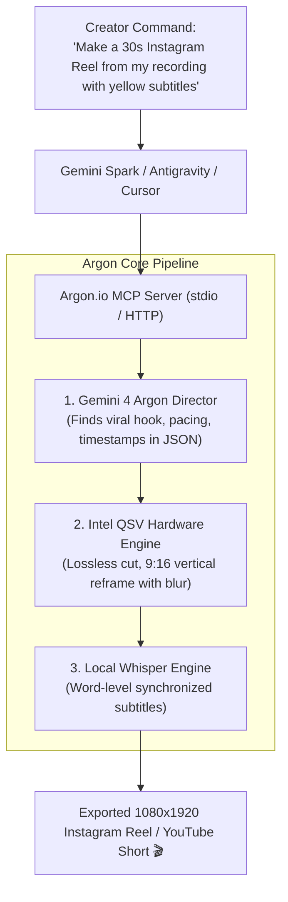

# 🎬 Argon.io (`argon.io`)

> **Autonomous AI Video Director & Reels Engine powered by Gemini 4 Argon, Intel QSV Hardware Acceleration, and the Model Context Protocol (MCP).**

[](https://opensource.org/licenses/Apache-2.0)
[-8A2BE2.svg)](https://modelcontextprotocol.io/)
[-0071C5.svg)](https://www.intel.com/)
[](https://ai.google.dev/)

---

## 🌟 Overview

**Argon.io** is an open-source, AI-native video director and short-form creation engine. 

While tools like **Palmier Pro** are locked exclusively to macOS, **Argon.io** provides a universal, cross-platform (Windows, Linux, macOS) alternative powered by **Gemini 4 Argon's** deep temporal reasoning and local **Intel Quick Sync (QSV) / FFmpeg** hardware rendering.

Any AI client—including **Gemini Spark**, **Antigravity**, **Cursor**, or **Claude Desktop**—can connect to Argon.io over MCP to autonomously watch, cut, reframe, subtitle, and render viral 9:16 Instagram Reels and YouTube Shorts with zero cloud GPU fees and zero watermarks.

---

## 🏗️ Architecture



---

## ⚡ Key Capabilities

1. **Gemini 4 Argon Multimodal Director**:
   Watches raw video footage (MP4, MOV, WebM), evaluates audience retention curves, eliminates dead air, and synthesizes an exact timestamped Edit Decision List (`ReelPlan`).
2. **Intel Iris Xe Hardware Rendering (QSV)**:
   Uses Direct3D11 and Intel Quick Sync (`-hwaccel qsv -c:v h264_qsv`) to render 1080×1920 60fps Reels at **150–250+ fps** with zero CPU strain.
3. **Smart 9:16 Reframe**:
   Automatically adapts horizontal 16:9 recordings into full 9:16 vertical video using blurred mirrored background padding.
4. **Local Kinetic Subtitles (OpenAI Whisper)**:
   Generates animated 3-4 word highlight subtitles directly from audio offline.
5. **Lossless Slicing**:
   Cuts clips in under 0.2 seconds via stream copy without re-encoding.

---

## 🔌 Connecting Argon.io to AI Clients (The Palmier.io Method)

Argon.io is a 100% standalone MCP server that can be connected to any AI model, whether running in the **cloud (Gemini Spark)** or locally on your **desktop (Claude Desktop, Cursor, Antigravity)**.

### 🌐 Method 1: Connecting to Online Gemini Spark (Web AI)

Because Gemini Spark runs in your web browser, it connects to your PC via a secure public MCP endpoint (just like Palmier's remote method):

1. **Launch the Argon MCP Server with Tunnel**:
   ```bash
   argon serve --spark
   ```
   *Argon will automatically launch a high-speed Cloudflare HTTPS tunnel and display:*
   ```
   =================================================================
   🚀 ARGON.IO IS LIVE & READY FOR GEMINI SPARK!
   =================================================================
   👉 Gemini Spark MCP URL: https://<random-id>.trycloudflare.com/mcp
   👉 Local Direct URL    : http://127.0.0.1:8080/mcp
   =================================================================
   ```

2. **Add to Gemini Spark**:
   - Open **[Gemini Spark](https://gemini.google.com/spark)**.
   - Go to **Settings > Connected Apps / MCP Tools**.
   - Click **Add Custom MCP** and paste your URL:
     ```
     https://<random-id>.trycloudflare.com/mcp
     ```

3. **Autonomously Direct Reels with Gemini 4 Argon**:
   > *"Argon, inspect `C:\recordings\podcast.mp4`, select the most viral 30-second punchline, reframe it to 9:16 vertical, and burn kinetic Whisper subtitles."*

---

### 💻 Method 2: Connecting to Local Desktop Clients (Claude Desktop, Cursor, Antigravity)

For desktop AI tools that run locally on your operating system, Argon connects directly via high-speed zero-overhead `stdio`:

Add to your `claude_desktop_config.json` or `mcp_settings.json`:
```json
{
  "mcpServers": {
    "argon": {
      "command": "argon"
    }
  }
}
```
*Argon will start instantly on demand whenever your desktop AI assistant needs video editing tools.*

---

## 🛠️ MCP Tools Reference

| MCP Tool | Description |
| :--- | :--- |
| `argon_create_instagram_reel` | Full autonomous pipeline: directs, slices, reframes (9:16), and subtitles a video. |
| `argon_reframe_to_vertical` | Converts 16:9 video to 9:16 (1080×1920) with blurred background padding via Intel QSV. |
| `argon_generate_subtitles` | Runs local Whisper speech-to-text to generate word-level synchronized `.srt` subtitles. |
| `argon_lossless_cut` | Instant stream-copy cut of any timestamp segment. |
| `argon_get_video_info` | Returns video duration, resolution, fps, bitrate, and codecs via `ffprobe`. |

---

## 💻 Local CLI / Python Usage

```python
from argon import VideoEngine, CaptionGenerator

# 1. Reframe landscape video to 9:16 vertical Reel
engine = VideoEngine(use_gpu=True)
engine.reframe_to_vertical("raw_lecture.mp4", "vertical_reel.mp4")

# 2. Generate Whisper captions
captions = CaptionGenerator(model_size="base")
captions.generate_srt("vertical_reel.mp4", "captions.srt")

# 3. Burn subtitles
engine.burn_subtitles("vertical_reel.mp4", "captions.srt", "final_reel.mp4")
```

---

## 📄 License
Apache-2.0 License. Developed by **Nandhakumar Murugan** (`smnk2006@gmail.com`).
